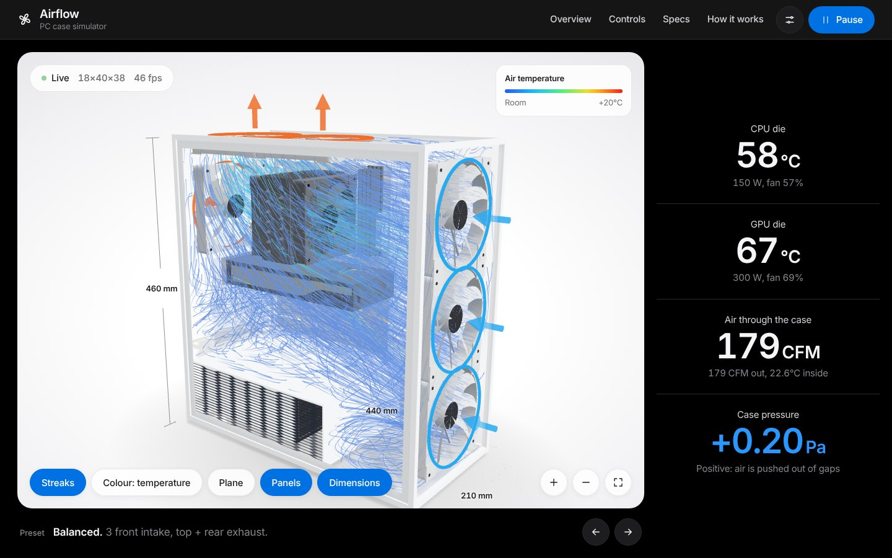

# PC Airflow Simulator

An interactive 3D simulator of airflow and heat inside a mid-tower PC case. You can rearrange the case fans, change component power, and watch air streaks, temperatures and case pressure respond as you go.



## Run it

```bash
npm install
npm run dev        # http://localhost:5173
npm run build      # static site in dist/
npm test           # physics sanity tests (Node 20+)
```

## What you can do

- **Fan slots**: 3 front, 3 top, 1 rear and 1 bottom. Each slot can be an intake fan, an exhaust fan, an open mesh vent, or covered. Set them from the side panel, or click a slot in the 3D view to cycle through the modes.
- **Presets**: balanced, positive pressure, negative pressure, chimney, stock (rear fan only), backwards, and passive.
- **Load**: CPU and GPU power, room temperature, case fan speed. The cooler fans either follow a temperature curve or run at a fixed speed you set.
- **Readouts**: CPU and GPU die temperatures (with thermal throttling), average, exhaust and hottest air temperatures, CFM per fan, passive vent flow, and case pressure in pascals.
- **Visualisation**: streaks coloured by air temperature, speed, or the inlet the air came through. There's also a movable cross-section plane that shows speed, temperature or pressure, plus slow motion, pause and single-step.

## Modelled hardware

| Part | Model |
| --- | --- |
| Case | Original minimal ATX airflow case, 210 x 460 x 440 mm inside. Perforated front and top, glass side. Fan mounts: 3 x 140 mm front, 2 x 140 mm top, 1 x 140 mm rear, 1 x 140 mm bottom. |
| Case fans | 140 x 140 x 25 mm: 155.6 m³/h (92 CFM) and 2.56 mm H₂O at 1500 rpm. Used in every slot. |
| CPU cooler | Single tower, 158 x 125 x 112 mm, seven heatpipes. Fins are parallel to the motherboard, with two 120 mm fans in push-pull (102.1 m³/h, 2.34 mm H₂O each at 2000 rpm). |
| Graphics card | Workstation blower: 267 x 111 x 40 mm dual-slot, 300 W. One radial blower pulls air in through both faces and blows it through an enclosed fin stack and out of the slotted bracket. |
| RAM | Four bare DDR5 DIMMs, 133.35 x 31.25 mm. |
| PSU | 1600 W ATX unit, 150 x 86 x 210 mm, 135 mm hybrid fan (off until warm), Titanium-class efficiency curve. Fan down (fresh air from the floor, its own airflow path) or fan up (draws case air and works as an extra exhaust). |

Fan and cooler figures come from the manufacturers' data sheets; the PSU ratings are typical figures. Change them in `src/sim/model.js`.

## How the simulation works

| Piece | Model |
| --- | --- |
| Air | Incompressible flow on a staggered 3D grid (low / medium / high = 15 / 11.5 / 9 mm cells). Each step does semi-Lagrangian advection, then buoyancy and drag, then a pressure projection with red-black SOR. |
| Case fans | Fixed-flux faces that follow a linear static-pressure curve (Q = s·Qmax·(1 − Δp / s²Pmax)), so fans lose flow when they have to push against restrictive vents. |
| Vents | Open slots and the rear expansion-slot covers. Their flow is set by pressure, so mismatched intake and exhaust shows up as real positive or negative case pressure. |
| Heatsinks | Porous blocks with drag that depends on direction (tower fins resist vertical flow, GPU fins resist flow along the card), plus internal fans with their own pressure curves. A GPU shroud plate stops air from short-circuiting. |
| Heat | Each heatsink has a temperature. Heat moves into the air passing through it, with a conductance that rises with local air speed. Temperature is carried by a conservative upwind scheme, so the heat that leaves with the exhaust matches the heat put in. The die temperature is the heatsink temperature plus P·Rjc. |

It's an educational model, not a CFD package. The grid is coarse and turbulence is approximated by damping, but the trends hold up. Tests in `test/` check divergence, mass conservation, energy conservation, pressure sign, fan starvation, and that good airflow beats passive cooling.

## Layout

```
src/sim/model.js        case geometry, fan slots, parts, presets
src/sim/fluid.js        MAC grid solver (advection, forces, projection, heat transport)
src/sim/simulation.js   builds the grid from the model; fans, heat exchange, stats
src/sim/worker.js       runs the simulation in a Web Worker and streams snapshots
src/render/*.js         Three.js case model, particle streaks, slice plane, colour maps
src/ui/*.jsx           React UI (top bar, overlays, cards, settings)
src/ui/store.js         small store linking the engine to React
src/engine.js           Three.js scene, picking, main loop, worker control
```
